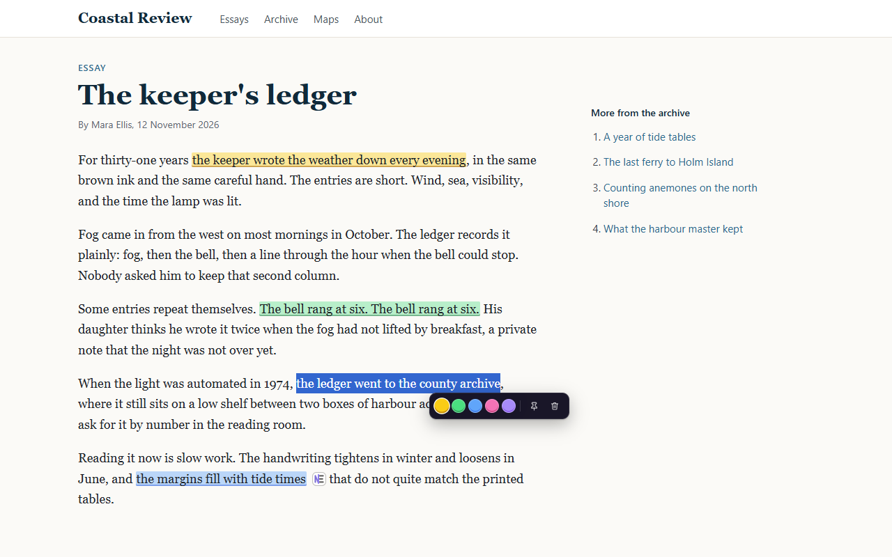
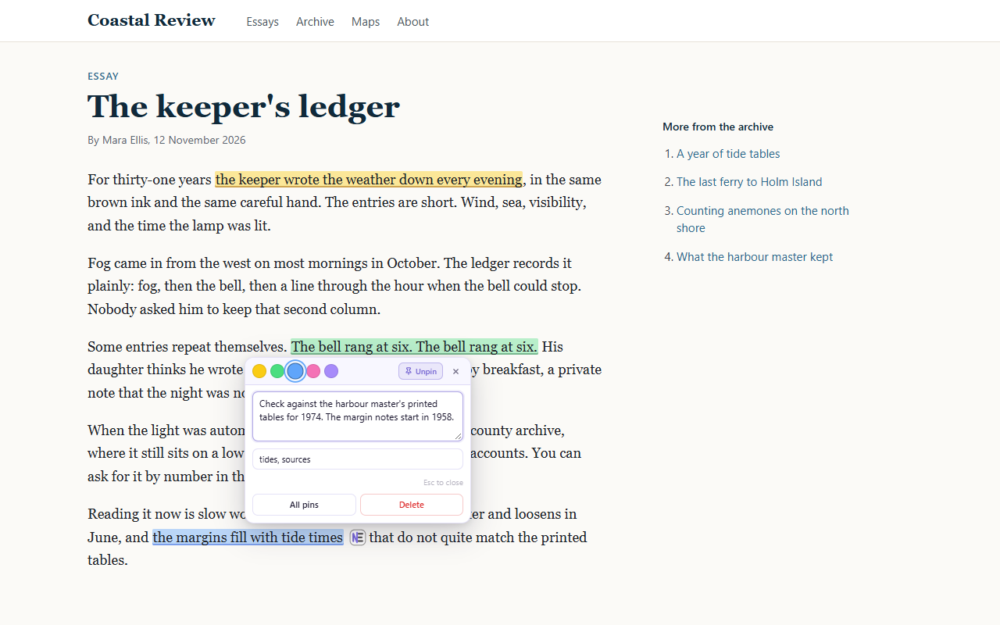
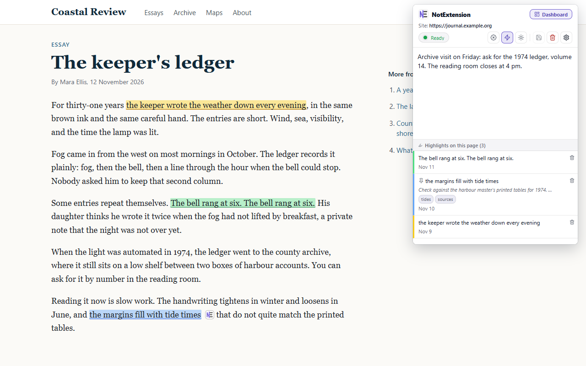
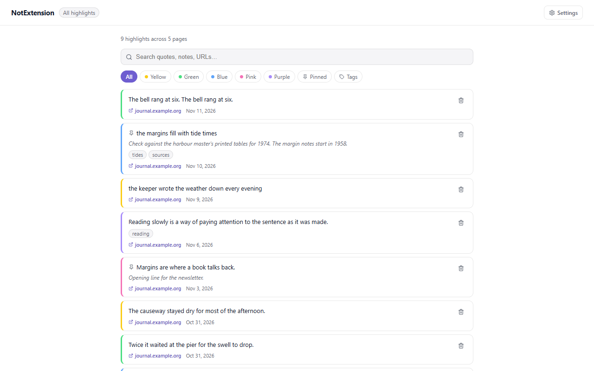

# NotExtension

Highlight text, pin notes and keep one note per site on any web page. Everything stays in your browser: no account,
no server, no tracking.

## Install

- **Chrome Web Store:** submitted for review; the link appears here once it is published.
- **Opera add-ons:** submitted for review; the link appears here once it is published.
- **From the release zip** (Chrome 116 or later, Opera):
  1. Download `notextension-<version>-chromium.zip` from the [latest release](../../releases/latest).
  2. Unzip it into a folder you will keep; the browser loads the extension from there.
  3. Open `chrome://extensions` (in Opera, `opera://extensions`), turn on **Developer mode**, click **Load unpacked**
     and choose the folder.

  An extension installed this way does not update itself. Download the next release, or switch to the store version
  once it is out.

## What it does

- **Highlight.** Select text and a small toolbar appears under the selection; pick one of five colours. Highlights come
  back when you return to the page. Alt+H highlights the selection without the toolbar.
- **Pin.** Pin a highlight to add a note and tags. A small mark next to the text opens the note again, and the pins
  panel lists every pin on the page.
- **Site note.** The popup keeps one free-text note for each website, next to the page's highlights.
- **Dashboard.** Every highlight across all pages, with search and colour filters. It opens a page at the highlight you
  choose.
- **Your data.** Export highlights as JSON or Markdown, notes and settings as JSON; import them back.
- **Light and dark** themes for the popup, settings and dashboard.

## Keyboard

| Action | Windows, Linux | macOS |
|---|---|---|
| Open the popup | Alt+Shift+N | Control+Shift+N |
| Highlight the selection | Alt+H | Control+Shift+H |

These are suggested keys. If another extension already uses one, the browser leaves it free; set your own at
`chrome://extensions/shortcuts` (in Opera, `opera://extensions/shortcuts`).

## Privacy

NotExtension stores your highlights, notes and settings in the browser on this device (`chrome.storage.local`). It
makes no network requests and sends nothing to anyone. The full policy is in [PRIVACY.md](PRIVACY.md).

## Releases and source

Each [release](../../releases) has the extension zip, the source it was built from (`notextension-<version>-source.zip`,
with build steps in `docs/BUILD.md`), and the list of changes.

## Feedback

Found a problem or have an idea? [Open an issue](../../issues).

## License

[MIT](LICENSE)
